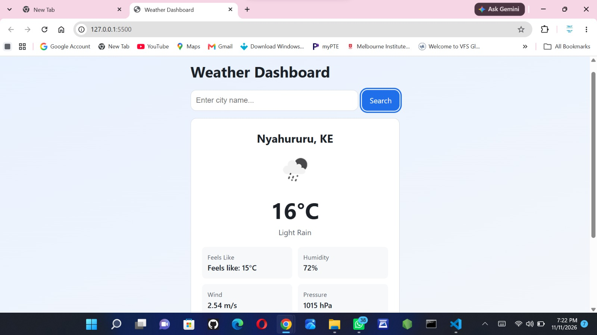

# Week 6: Weather App

## Author
- **Name:** Caroline Wanjira
- **GitHub:** [@Caroline-wanjira](https://github.com/Caroline-wanjira)
- **Date:** 10th November, 2026.

## Project Description
I created a rensponsive weather app built to demonstrate asynchronus JS and API integration. This app fetches real time weather.

## Technologies Used
- HTML5
- CSS3
- JavaScript
- Visual Studio Code with live server
- Git and github

## Features
- Real-Time Weather Search that fetches and displays live weather data for user-queried locations using the OpenWeather API.
- Secure Secret Management that Uses .gitignore to keep API keys private in local development and GitHub Repository Secrets during automated deployment.

## How to Run
1. Clone this repository

2. Open `index.html` in your browser or run it using VS code live server

## Lessons Learned
-  I learned how to separate sensitive credentials (like API keys) from source code by using `.gitignore` during local development.
-  I deepened my understanding of handling asynchronous operations using `fetch()`, `async/await`, and promises to make network requests without blocking the user .

## Challenges Faced
- I needed to hide my OpenWeather API key while keeping the app functional on GitHub Pages. I solved this by adding `config.js` to `.gitignore` so it wouldn't push to GitHub, and then configured a GitHub Actions workflow that reads an `OPENWEATHER_API_KEY`.
- My initial deployment failed because `.deploy.yml` wasn't in the correct directory. I resolved this by creating the exact folder path `.github/workflows/deploy.yml` at the root level of my workspace. 

## Screenshots 

## Live Demo 
[Weather App](https://caroline-wanjira.github.io/iyf-s12-week-06-Caroline-wanjira/)
